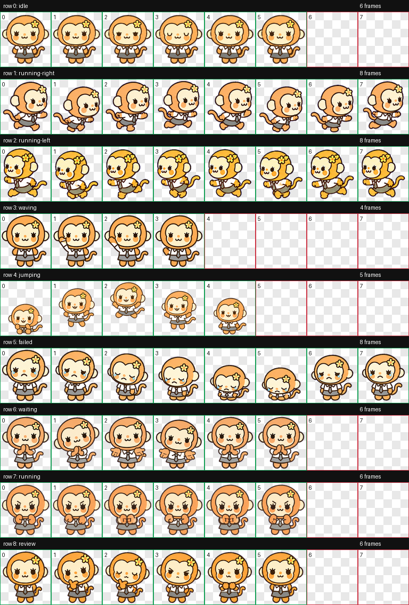

# 卢小猴 (Nosungi Pet)

会带来好运、积极又有点害羞的卢小猴，穿着 A-NA 出道 Showcase 服装。

## 功能特性

- 9 种动画状态：待机、左右移动、挥手、跳跃、失败、等待用户、工作中、审阅
- 透明度校验通过，无残留色边
- 精灵表格式：WEBP，1536×1872，RGBA
- 每帧尺寸：192×208 像素

## 动画状态

| 状态 | 帧数 | 说明 |
|------|------|------|
| idle | 6 | 待机状态 |
| running-right | 8 | 向右移动 |
| running-left | 8 | 向左移动 |
| waving | 4 | 挥手 |
| jumping | 5 | 跳跃 |
| failed | 8 | 失败状态 |
| waiting | 6 | 等待用户 |
| running | 6 | 工作中 |
| review | 6 | 审阅状态 |

## 文件结构

```
nosungi-pet/
├── pet.json              # 宠物定义文件
├── spritesheet.webp      # 精灵表（包含所有动画帧）
├── qa/
│   ├── contact-sheet.png # 动画预览总览
│   └── previews/         # 各状态 GIF 预览
│       ├── idle.gif
│       ├── running-right.gif
│       ├── running-left.gif
│       ├── waving.gif
│       ├── jumping.gif
│       ├── failed.gif
│       ├── waiting.gif
│       ├── running.gif
│       └── review.gif
└── README.md
```

## 安装与使用

### 在 Codex 中使用

1. 将 `pet.json` 和 `spritesheet.webp` 复制到 Codex 的宠物目录：
   - Windows: `C:\Users\<用户名>\.codex\pets\nosungi\`
   - macOS/Linux: `~/.codex/pets/nosungi/`

2. 重启 Codex，卢小猴即可出现在宠物列表中

### 额度查询（可选）

配套技能 `$nosungi-usage` 可实时显示 Codex 账户剩余额度和重置时间。该技能未包含在此公开仓库中，如有需要请联系作者。

## 预览



各状态独立预览见 `qa/previews/` 目录。

## 技术细节

- 精灵表格式：WEBP (RGBA)
- 帧提取方式：stable-slots
- 透明度校验：0 残留像素
- 无边缘伪影，无色度溢出

## 许可证

本项目仅供个人使用和学习交流。

## 作者

- GitHub: [@2002XiaoYu](https://github.com/2002XiaoYu)
